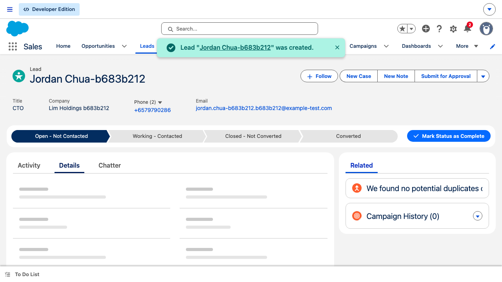

# GovTech – Salesforce CRM QA Automation

Playwright + TypeScript automation framework for the Salesforce CRM Lead →
Opportunity assessment (see `GovTech  - QA - Assesment Testv1.pdf`).

> Looking for how each assessment requirement maps to the code, and the key
> design decisions behind it? See [SOLUTION.md](SOLUTION.md).

## Project structure

```
src/
  config/        # env.ts - centralised, validated environment configuration
  utils/         # logger, Salesforce Id (15->18) conversion, IMAP OTP reader
  data/          # randomized Lead test-data factory (unique per call/worker)
  pages/         # Page Object Model (Login, AppLauncher, LeadForm, LeadDetail,
                 # ConvertLead, OpportunityDetail)
tests/
  fixtures/      # custom Playwright fixtures wiring up the page objects
  setup/         # auth.setup.ts - logs in once (handling OTP) and caches
                 # storageState.json for every other test to reuse
  *.spec.ts      # Part A/B/C test scenarios
playwright.config.ts
```

## Prerequisites

- Node.js 20.19+ or 22.13+ (see `.nvmrc`-less requirement from `package.json`
  devDependencies; any current LTS works).
- A Salesforce Developer Edition org: https://developer.salesforce.com/signup
  - **This is the assessment brief's steps 1-2 (sign up / verify the org) and
    is intentionally a one-time, manual, out-of-scope step** - it's a public
    web sign-up gated by email verification and (for repeat/automated
    attempts) a CAPTCHA, neither of which this framework automates. It's also
    not a repeatable test *scenario* the way Lead creation/conversion are -
    you do it once per org, by hand, before any test ever runs.
- An inbox you control that receives the org's emails, if you want the OTP
  step automated (see below).

## Setup

```bash
npm install
npx playwright install        # downloads the Chromium/WebKit browser binaries
cp .env.example .env           # then fill in the values described below
```

`.env` variables:

| Variable | Purpose |
|---|---|
| `SF_BASE_URL` | Login URL, defaults to `https://login.salesforce.com` |
| `SF_USERNAME` / `SF_PASSWORD` | Your Developer Edition credentials |
| `SF_SECURITY_TOKEN` | Only needed if your org enforces it for API calls from untrusted IPs - appended to the password for the background SOAP login in `src/utils/salesforceApi.ts` (used to look up existing Account/Contact fixtures), **not** for the interactive UI login/OTP flow below, which never needs it |
| `STORAGE_STATE_PATH` | Where the authenticated session is cached (default `playwright/.auth/user.json`, gitignored) |
| `OTP_AUTOMATION_ENABLED` | `true` to auto-read the email verification code, `false` to enter it manually once |
| `OTP_IMAP_*` | IMAP credentials for the inbox that receives Salesforce's verification email |

## Running the tests

```bash
npm test                 # all specs, Chromium + WebKit
npm run test:chromium    # Chromium only
npm run test:webkit      # WebKit only
npm run test:smoke       # @smoke-tagged tests only, Chromium + WebKit
npm run test:headed      # headed/debug run
npm run test:ui          # Playwright UI mode
```

The first run executes the `setup` project (`tests/setup/auth.setup.ts`),
which logs in, handles the email verification challenge if presented, and
writes `playwright/.auth/user.json`. Every subsequent `chromium`/`webkit`
test project depends on `setup` and reuses that cached state — the setup
project itself re-validates the cache first and only logs in again if it's
missing or expired, so it never blindly trusts a stale cache.

## Viewing the report

```bash
npm run report
```

This opens the HTML report (`playwright-report/`). A machine-readable
summary is also written to `test-results/results.json`, and a plain-text run
log is appended to `test-results/run.log` on every execution.

## Part C.a — Shadow DOM / dynamic Lightning component evidence



The screenshot above is the Lead Status **Path** component (the stage bar:
"Open - Not Contacted" / "Working - Contacted" / ...), captured live on a
just-created Lead. `LeadDetailPage.editStatus()` is the code that drives it
- it's an Aura component (`runtime_sales_pathassistantPathAssistantTab`), not
a plain field, so it's the one actually exercised by this suite (unlike a
plain combobox, which the suite never needed special handling for). Its
rendered markup, captured via `element.outerHTML` in two separate live runs
against this org, is:

```html
<!-- run 1 -->
<li ... data-aura-rendered-by="2233:0" data-name="Open - Not Contacted" ...>
  <a role="option" aria-label="Open - Not Contacted" data-aura-rendered-by="2234:0" ...>
<!-- run 2, same component, same org -->
<li ... data-aura-rendered-by="2205:0" data-name="Open - Not Contacted" ...>
  <a role="option" aria-label="Open - Not Contacted" data-aura-rendered-by="2206:0" ...>
```

There's no `id` attribute anywhere on this component at all - the only
per-element anchor Aura renders is `data-aura-rendered-by`, and the two runs
above show it's a render-tree counter that's reassigned on every page load,
so hard-coding it (or guessing `:nth-child` position, since which stages
appear depends on the record's page layout) would be fragile. What *is*
stable across both runs is `role="option"` + the stage's own label as the
accessible name (`aria-label="Working - Contacted"`, etc.) - exactly what
`editStatus()` targets via `getByRole('option', { name: newStatus, exact: true })`.

Two corrections to an earlier version of this write-up, checked directly
against this org rather than assumed:
- **`.slds-combobox__input` doesn't "break" - it's ambiguous.** It's a
  static SLDS framework class that's actually present and unchanged across
  reloads; the real problem is that `page.locator('.slds-combobox__input').count()`
  returns **11** matches on the New Lead form alone, so it can't identify a
  *specific* field without an arbitrary (and fragile) index.
- **Shadow-piercing isn't the differentiator.** `element.getRootNode()
  instanceof ShadowRoot` is `true` for these components in this org (real
  native Shadow DOM, not a synthetic/light-DOM polyfill), but Playwright's
  CSS engine pierces open shadow roots automatically too, same as its
  role/text engines - confirmed by the `.slds-combobox__input` count above
  actually finding matches despite the shadow boundary. The reason role
  locators are used here isn't shadow-piercing; it's that the accessible
  name is the one attribute on these components that's simultaneously
  stable *and* unique, unlike a generated id/render-counter (changes every
  load) or a bare class (shared by every combobox on the page).

The real debugging cost of this component: a post-save success toast in
WebKit specifically can sit on screen long enough to physically overlap the
Path bar and intercept clicks on its `option`s before it naturally
dismisses - `editStatus()` calls `waitForToastToClear()` first for exactly
this reason (see `src/pages/LeadDetailPage.ts`).

The same accessible-role approach is used for every other Lightning
combobox/lookup in this framework - `BasePage.selectCombobox()` (exercised
in `LeadFormPage` against the **Lead Source** field) and
`BasePage.fillLookupAndSelect()` both target `role`+accessible name instead
of CSS, and the Convert Lead dialog's Account/Contact search
(`ConvertLeadPage.resolveAccount()`/`resolveContact()`) does the same
against its own dynamically-rendered typeahead `option`s.

## Part C.b — Handling the email verification code on login

Salesforce challenges any login from an unrecognized browser/device with a
6-digit emailed code. This framework automates it as follows
(`src/utils/otpMailReader.ts`, wired into `LoginPage.completeVerificationChallenge`):

1. `auth.setup.ts` first tries the **cached** `storageState.json` in a
   throwaway browser context and checks it's still logged in — it never
   assumes the cache is valid.
2. If the cache is missing/expired, it performs a real login. If Salesforce
   responds with the verification challenge, it polls the configured IMAP
   inbox (`OTP_IMAP_*`) for the "Verify Your Identity" email sent after the
   login attempt, extracts the 6-digit code, and submits it (also checking
   "remember this device" where offered so cookies carry trust forward).
3. On success it re-caches `storageState.json` for subsequent runs.

**Tradeoffs considered:**
- *Disposable inbox service (Mailosaur/Mailtrap, etc.)* — purpose-built API
  for exactly this, no real credentials to leak, easy CI rotation, but adds
  a paid third-party dependency and another secret to manage.
- *A real mailbox via IMAP (chosen here)* — zero extra cost/service
  dependency, works with any provider; the tradeoff is the mailbox
  app-password is a real credential that must be stored as a CI secret and
  scoped to a dedicated test-only account (never a personal/production inbox)
  to limit blast radius if leaked.
- *Relying on an org Trusted IP Range to skip the challenge entirely* — most
  robust for CI (no email dependency at all), but it's an org Setup change a
  Salesforce admin must make out-of-band, not something the test code can
  configure, and it weakens the org's login security posture, so it's noted
  here as an alternative rather than the default.- *A session-token bypass via `frontdoor.jsp?sid=`* - once a SOAP/REST login
  with `SF_SECURITY_TOKEN` returns a session id (already done for the
  Account/Contact fixture lookups in `src/utils/salesforceApi.ts`), that
  session id can be handed to a browser via
  `https://<instance>/secur/frontdoor.jsp?sid=<sessionId>` to get an
  authenticated page without ever driving the login form - a genuine way to
  skip the OTP challenge entirely, including in CI with no email dependency.
  Not used here because it would mean the suite stops exercising the real
  login + OTP UI flow at all, which the assessment brief specifically asks to
  automate (Part A); it's a reasonable alternative for suites where login
  itself isn't a tested scenario, just a precondition.
## API / response validation notes (Part B bonus)

See [NOTES.md](NOTES.md) for the observed Lead→Opportunity conversion
network call shape and which response fields are asserted on.

## Continuous Integration

`.github/workflows/playwright.yml` runs the full suite (Chromium + WebKit)
on every push/PR to `main`, and uploads the HTML report + traces/screenshots
as workflow artifacts regardless of pass/fail. It intentionally does **not**
cache `storageState.json` between runs — CI runners are ephemeral, so every
run exercises the real login + OTP-retrieval path (matching the assessment's
"cache deleted in CI" scenario) rather than assuming a cache exists.

Add these as **repository Settings → Secrets and variables → Actions**
secrets before enabling the workflow:

| Secret | Value |
|---|---|
| `SF_BASE_URL` | Your org's login URL |
| `SF_USERNAME` / `SF_PASSWORD` | Developer org credentials |
| `SF_SECURITY_TOKEN` | Only needed if your org enforces it |
| `OTP_IMAP_HOST` / `OTP_IMAP_PORT` / `OTP_IMAP_USER` / `OTP_IMAP_PASSWORD` | A dedicated test-inbox app password (never a personal/production mailbox) |

## Known limitations

- The Convert Lead dialog's "Account Search" typeahead is backed by an
  asynchronous SOSL search index that can lag well behind a just-created
  record (observed still un-indexed 90+ seconds after creation). The
  existing-Account-match test (`lead-conversion.spec.ts`) works around this
  by reusing a fixed Company name across runs via a local state file
  (`.test-state/duplicate-match.json`, gitignored) instead of creating and
  immediately searching for the same Account in one run.
- `fullyParallel: true` plus `workers: undefined` locally means Playwright
  auto-detects a worker count that can exceed CI's capped `workers: 2`,
  putting more simultaneous load on the live org than CI ever will. If the
  full suite flakes locally (dialog/timeout flakes, not assertion mismatches),
  re-run with `--workers=2` to match CI before treating it as a real bug.
- The duplicate-detection negative test soft-skips itself
  (`test.skip(...)`) if the org has no duplicate rule configured for Lead
  email, since that's an org configuration precondition, not something the
  test can create.
- After a lot of live test runs against the same dev org (this suite creates
  a real Lead/Account/Contact per run), Salesforce's fuzzy duplicate-rule
  Account Search in the Convert Lead dialog can start surfacing unrelated
  prior fixture records as "possible matches" for a brand-new Account name,
  occasionally interrupting the conversion smoke test. This is org test-data
  clutter from repeated runs, not a defect in the suite - periodically
  cleaning out old fixture Accounts/Leads/Opportunities in the dev org avoids
  it. `npm run test:smoke` is the fastest way to get a quick Chromium +
  WebKit confidence check without a full run; run it with `--workers=1` if
  you hit this, since the conversion flow is the heaviest single action in
  the suite and benefits from not contending with a second worker for the
  same live org.
