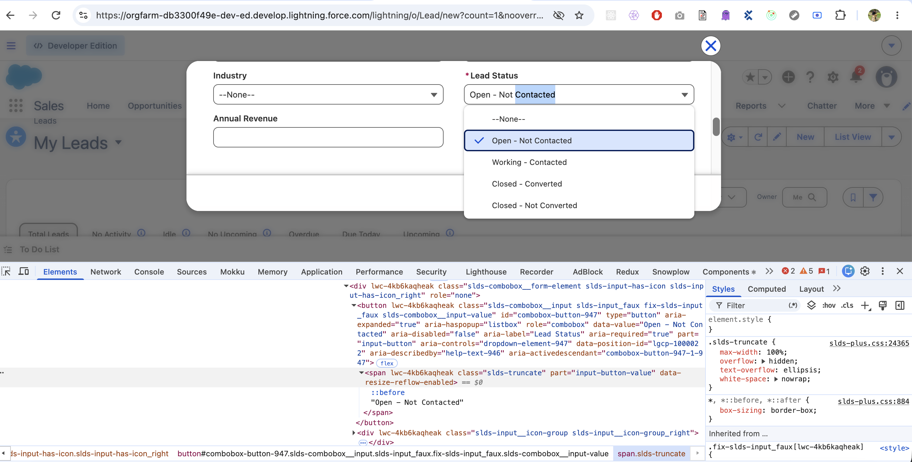

# GovTech – Salesforce CRM QA Automation

Playwright + TypeScript automation framework for the Salesforce CRM Lead →
Opportunity assessment (see `GovTech  - QA - Assesment Testv1.pdf`).

## Project structure

```
src/
  config/        # env.ts - centralised, validated environment configuration
  utils/         # logger, Salesforce Id (15->18) conversion, IMAP OTP reader
  data/          # randomized Lead test-data factory (unique per call/worker)
  pages/         # Page Object Model (Login, AppLauncher, LeadForm, LeadDetail,
                 # ConvertLead, OpportunityDetail)
tests/
  fixtures/      # custom Playwright fixtures wiring up the page objects
  setup/         # auth.setup.ts - logs in once (handling OTP) and caches
                 # storageState.json for every other test to reuse
  *.spec.ts      # Part A/B/C test scenarios
playwright.config.ts
```

## Prerequisites

- Node.js 20.19+ or 22.13+ (see `.nvmrc`-less requirement from `package.json`
  devDependencies; any current LTS works).
- A Salesforce Developer Edition org: https://developer.salesforce.com/signup
- An inbox you control that receives the org's emails, if you want the OTP
  step automated (see below).

## Setup

```bash
npm install
npx playwright install        # downloads the Chromium/WebKit browser binaries
cp .env.example .env           # then fill in the values described below
```

`.env` variables:

| Variable | Purpose |
|---|---|
| `SF_BASE_URL` | Login URL, defaults to `https://login.salesforce.com` |
| `SF_USERNAME` / `SF_PASSWORD` | Your Developer Edition credentials |
| `STORAGE_STATE_PATH` | Where the authenticated session is cached (default `playwright/.auth/user.json`, gitignored) |
| `OTP_AUTOMATION_ENABLED` | `true` to auto-read the email verification code, `false` to enter it manually once |
| `OTP_IMAP_*` | IMAP credentials for the inbox that receives Salesforce's verification email |

## Running the tests

```bash
npm test                 # all specs, Chromium + WebKit
npm run test:chromium    # Chromium only
npm run test:webkit      # WebKit only
npm run test:headed      # headed/debug run
npm run test:ui          # Playwright UI mode
```

The first run executes the `setup` project (`tests/setup/auth.setup.ts`),
which logs in, handles the email verification challenge if presented, and
writes `playwright/.auth/user.json`. Every subsequent `chromium`/`webkit`
test project depends on `setup` and reuses that cached state — the setup
project itself re-validates the cache first and only logs in again if it's
missing or expired, so it never blindly trusts a stale cache.

## Viewing the report

```bash
npm run report
```

This opens the HTML report (`playwright-report/`). A machine-readable
summary is also written to `test-results/results.json`, and a plain-text run
log is appended to `test-results/run.log` on every execution.

## Part C.a — Shadow DOM / dynamic Lightning component evidence



The screenshot above is the New Lead form's **Lead Status** field, inspected
live in this org. The rendered markup is:

```html
<button lwc-4kb6kaqheak class="slds-combobox__input slds-input-faux fix-sds-input_faux slds-combobox__input-value"
        id="combobox-button-947" type="button"
        role="combobox" aria-haspopup="listbox" aria-expanded="true"
        aria-label="Lead Status" aria-required="true"
        aria-controls="dropdown-element-947" ...>
```

A naive locator such as `#combobox-button-947` or `.slds-combobox__input`
doesn't hold up: the `-947` suffix on the `id` and the `lwc-4kb6kaqheak`
scoping class are both generated per page load/build by the Lightning Web
Component runtime, so they change between sessions and deployments -
hard-coding either would break on the very next run.

What *is* stable is the accessible contract the component renders:
`role="combobox"` + `aria-label="Lead Status"`. That's exactly what
`BasePage.selectCombobox('Lead Status', ...)` targets via
`getByRole('combobox', { name: 'Lead Status' })`, and the same reasoning is
why `BasePage.fillLookupAndSelect()` uses `getByRole('option', ...)` for
lookup/typeahead results instead of CSS. Playwright also pierces open shadow
roots automatically for role/text engines, so this accessibility-first
approach keeps working even where the component's internal DOM is further
nested inside a shadow boundary.

## Part C.b — Handling the email verification code on login

Salesforce challenges any login from an unrecognized browser/device with a
6-digit emailed code. This framework automates it as follows
(`src/utils/otpMailReader.ts`, wired into `LoginPage.completeVerificationChallenge`):

1. `auth.setup.ts` first tries the **cached** `storageState.json` in a
   throwaway browser context and checks it's still logged in — it never
   assumes the cache is valid.
2. If the cache is missing/expired, it performs a real login. If Salesforce
   responds with the verification challenge, it polls the configured IMAP
   inbox (`OTP_IMAP_*`) for the "Verify Your Identity" email sent after the
   login attempt, extracts the 6-digit code, and submits it (also checking
   "remember this device" where offered so cookies carry trust forward).
3. On success it re-caches `storageState.json` for subsequent runs.

**Tradeoffs considered:**
- *Disposable inbox service (Mailosaur/Mailtrap, etc.)* — purpose-built API
  for exactly this, no real credentials to leak, easy CI rotation, but adds
  a paid third-party dependency and another secret to manage.
- *A real mailbox via IMAP (chosen here)* — zero extra cost/service
  dependency, works with any provider; the tradeoff is the mailbox
  app-password is a real credential that must be stored as a CI secret and
  scoped to a dedicated test-only account (never a personal/production inbox)
  to limit blast radius if leaked.
- *Relying on an org Trusted IP Range to skip the challenge entirely* — most
  robust for CI (no email dependency at all), but it's an org Setup change a
  Salesforce admin must make out-of-band, not something the test code can
  configure, and it weakens the org's login security posture, so it's noted
  here as an alternative rather than the default.

## API / response validation notes (Part B bonus)

See [NOTES.md](NOTES.md) for the observed Lead→Opportunity conversion
network call shape and which response fields are asserted on.

## Continuous Integration

`.github/workflows/playwright.yml` runs the full suite (Chromium + WebKit)
on every push/PR to `main`, and uploads the HTML report + traces/screenshots
as workflow artifacts regardless of pass/fail. It intentionally does **not**
cache `storageState.json` between runs — CI runners are ephemeral, so every
run exercises the real login + OTP-retrieval path (matching the assessment's
"cache deleted in CI" scenario) rather than assuming a cache exists.

Add these as **repository Settings → Secrets and variables → Actions**
secrets before enabling the workflow:

| Secret | Value |
|---|---|
| `SF_BASE_URL` | Your org's login URL |
| `SF_USERNAME` / `SF_PASSWORD` | Developer org credentials |
| `SF_SECURITY_TOKEN` | Only needed if your org enforces it |
| `OTP_IMAP_HOST` / `OTP_IMAP_PORT` / `OTP_IMAP_USER` / `OTP_IMAP_PASSWORD` | A dedicated test-inbox app password (never a personal/production mailbox) |

## Known limitations

- Locators in `src/pages/*` are written against Salesforce Lightning's
  documented/standard markup (accessible roles, labels) but have **not** been
  validated against a live org yet — run `npm run codegen` against your org
  to confirm/adjust selectors (especially `ConvertLeadPage` and the Status
  inline-edit flow) before relying on a green run.
- The duplicate-detection negative test soft-skips itself
  (`test.skip(...)`) if the org has no duplicate rule configured for Lead
  email, since that's an org configuration precondition, not something the
  test can create.
