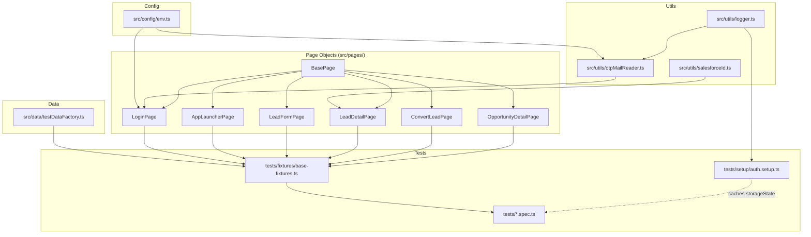

# Solution Walkthrough

This document explains **what this repo is, how it's put together, and
exactly how each requirement in `GovTech  - QA - Assesment Testv1.pdf` was
implemented**. For setup/run instructions see [README.md](README.md); for
the Part B API payload and Part C.a evidence write-ups see [NOTES.md](NOTES.md).

## 1. What this is

A Playwright + TypeScript end-to-end test suite against a real Salesforce
Developer Edition org, covering:

- **Part A** — login, including the email OTP identity-verification challenge.
- **Part B** — Lead CRUD, Lead → Opportunity conversion (with Account/Contact
  existence checks), an API-level bonus assertion, and negative scenarios.
- **Part C** — evidence of handling a dynamic/shadow-DOM Lightning component,
  and the email OTP automation design.

It runs on both Chromium and WebKit, in parallel, with a GitHub Actions CI
workflow, and an unsquashed commit history showing the real build-and-debug
process (see `git log --oneline`).

## 2. Architecture

- **`src/config/env.ts`** — single source of truth for all env vars
  (`.env`), with `requireCredentials()` failing fast with a clear message
  instead of letting Salesforce silently reject a blank login.
- **`src/pages/*`** — Page Object Model. Every page object extends
  `BasePage`, which centralizes the handful of waiting/interaction patterns
  that are specific to Salesforce Lightning (see §6).
- **`tests/fixtures/base-fixtures.ts`** — wires page objects + a
  `uniqueLead` randomized-data fixture into Playwright's `test`, so every
  spec file destructures exactly the collaborators it needs.
- **`tests/setup/auth.setup.ts`** — a dedicated Playwright *project*
  (`setup`) that all browser projects `dependencies: ['setup']` on. It
  revalidates a cached `storageState.json` first, and only performs a real
  interactive login (+ OTP) if the cache is missing or dead.

## 3. Requirement-by-requirement mapping

### Part A — Login

| Requirement | Implementation |
|---|---|
| Log into a Salesforce org | [LoginPage.login()](src/pages/LoginPage.ts) fills username/password, handling both single-page and progressive (username-then-password) login forms. |
| Handle the email verification OTP challenge | [LoginPage.isVerificationChallengePresented()](src/pages/LoginPage.ts) / `completeVerificationChallenge()`, backed by [otpMailReader.ts](src/utils/otpMailReader.ts) — see §7. |
| Validate successful login | [tests/login.spec.ts](tests/login.spec.ts) asserts the post-login App Launcher / global search is visible. |
| Don't re-login on every test | `auth.setup.ts` caches `storageState.json`; `playwright.config.ts`'s `chromium`/`webkit` projects both declare `dependencies: ['setup']` and reuse that state. |

### Part B — Lead CRUD

| Requirement | Implementation |
|---|---|
| Create a Lead with required fields | [LeadFormPage.fill()](src/pages/LeadFormPage.ts) + `save()`, driven by randomized [createLeadData()](src/data/testDataFactory.ts) so parallel workers never collide on name/email/company. |
| Validate the generated Lead Id | [LeadDetailPage.getLeadId18()](src/pages/LeadDetailPage.ts) reads the Id out of the post-save URL and converts 15→18 chars via [salesforceId.ts](src/utils/salesforceId.ts)'s checksum algorithm, asserted in [tests/lead-creation.spec.ts](tests/lead-creation.spec.ts). |
| Edit a Lead (status) | [LeadDetailPage.editStatus()](src/pages/LeadDetailPage.ts) — Lead Status in Lightning is a **Path component** (a `listbox` of stage `option`s + a confirm button), not a plain field, so it's driven accordingly rather than via a generic combobox. |

### Part B — Lead → Opportunity conversion

| Requirement | Implementation |
|---|---|
| Convert a Lead | [ConvertLeadPage.convertAndCaptureResponse()](src/pages/ConvertLeadPage.ts) drives the real "Convert Lead" dialog and reads the resulting Account/Contact/Opportunity Ids off the confirmation screen's record links. |
| Check whether the Account already exists | [ConvertLeadPage.resolveAccount()](src/pages/ConvertLeadPage.ts) types into the "Account Search" typeahead and looks for an exact-name `option` match; falls back to "Create New Account" if none appears. |
| Check whether the Contact already exists | [ConvertLeadPage.resolveContact()](src/pages/ConvertLeadPage.ts) reads Salesforce's own auto-detected "X Contact Matches detected" status text (there's no manual search box for Contact). |
| Test both branches (new vs. existing) | [tests/lead-conversion.spec.ts](tests/lead-conversion.spec.ts) has one test for the all-new path and one for the existing-Account path (see §8 for why the existing-match test needs a persisted fixture). |

### Part B — API / response validation (bonus)

Salesforce Lightning doesn't expose a REST `/convert` endpoint — Convert
Lead is a Lightning/Aura action POSTed to the generic Aura endpoint.
`ConvertLeadPage.convertAndCaptureResponse()` listens for that network
response (`/convertLeadServer/i`), parses out the `Database.LeadConvertResult`-shaped
`returnValue`, and the first test in `lead-conversion.spec.ts` asserts on
`leadConvertResult.hasError === false` and the returned `opportunityId`
format. The full captured request/response payload is documented in
[NOTES.md](NOTES.md).

### Part B — Negative scenarios

| Scenario | Implementation |
|---|---|
| Missing mandatory fields | [tests/negative-scenarios.spec.ts](tests/negative-scenarios.spec.ts) saves a blank form and asserts `LeadFormPage.getFieldErrorMessages()` reports "complete this field" errors. |
| Duplicate Lead | Creates the same identity twice and asserts `LeadFormPage.getDuplicateWarningText()`; this org-configuration-dependent check self-skips (`test.skip`) if no duplicate rule is configured for Lead email, rather than failing on an environment precondition the test can't control. |

### Part C.a — Shadow DOM / dynamic Lightning component evidence

Documented with a live DevTools screenshot in
[README.md](README.md#part-ca--shadow-dom--dynamic-lightning-component-evidence)
and [NOTES.md](NOTES.md): the Lead Status combobox renders a
runtime-generated `id`/scoping class that changes per session/build, so the
framework targets the stable `role="combobox"` + `aria-label` accessible
contract instead (`BasePage.selectCombobox()` / `fillLookupAndSelect()`),
which Playwright resolves through shadow roots automatically.

### Part C.b — Email OTP automation

[otpMailReader.ts](src/utils/otpMailReader.ts) polls a real IMAP inbox for
Salesforce's verification email and extracts the 6-digit code; wired into
`LoginPage.completeVerificationChallenge()`. If `OTP_IMAP_*` isn't
configured, it falls back to pausing in the Playwright Inspector for manual
entry rather than failing outright. Tradeoffs vs. a disposable-inbox service
or a Trusted IP Range are discussed in [README.md](README.md#part-cb--handling-the-email-verification-code-on-login).

### Cross-browser, parallel execution, CI

- `playwright.config.ts` defines `chromium` and `webkit` projects, both
  depending on the shared `setup` project, with `fullyParallel: true`.
- `.github/workflows/playwright.yml` runs the full suite on both browsers
  on every push/PR, uploading the HTML report and `test-results/` (traces,
  screenshots, videos, logs) as artifacts regardless of outcome. CI
  intentionally does **not** persist `storageState.json` between runs, so
  every CI run exercises the real login + OTP path end-to-end.

### Git history

Built incrementally and left **unsquashed** on purpose — `git log --oneline`
shows the real sequence: scaffold → config/utils → test-data factory → page
objects → fixtures/auth setup → specs → CI → docs → a series of `fix:`
commits recording actual bugs found against the live org (locator
mismatches, WebKit-specific timing, the Lead-level duplicate-rule discovery,
etc.), each with a commit message explaining the root cause, not just "fix
test".

## 4. Design decisions that matter (and why)

These are the non-obvious choices that make the suite reliable against a
*live, real* org rather than a mocked one — read this before changing
`BasePage`, `LeadFormPage`, or `ConvertLeadPage`.

1. **Accessible-role locators over CSS/`data-*`.** Lightning Web Components
   regenerate internal ids/classes per session and build; `getByRole(...)`
   targets the accessibility tree, which is the actual stable contract (see
   Part C.a above).
2. **`waitForLightningReady()` spinner wait, never `networkidle`.**
   Lightning pages poll continuously in the background, so
   `page.waitForLoadState('networkidle')` can hang indefinitely. Every page
   object waits for `.slds-spinner_container` to become hidden instead.
3. **Toasts are actively dismissed, not just waited out.** Save-confirmation
   toasts can linger long enough to intercept clicks on the element
   underneath; `BasePage.waitForToastToClear()` clicks the toast's own close
   button rather than passing time and hoping.
4. **Two independent "duplicate" mechanisms exist in this org — don't
   conflate them.** A soft `/possible duplicate/i` warning banner (checked
   by the negative-scenarios test) is different from a **hard** Lead-level
   "Similar Records Exist" block dialog that fires only when a Lead becomes
   an *exact* duplicate (same company+first+last+email) of a prior Lead. The
   existing-Account-match conversion test deliberately randomizes
   name/email per run and only fixes `company`, specifically to avoid ever
   tripping the hard block.
5. **The Account-match test can't create-then-immediately-search.**
   Salesforce's SOSL search index can lag 90+ seconds (observed, sometimes
   much longer) behind a just-created record. Instead of a flaky in-test
   wait, `lead-conversion.spec.ts` persists the resolved Account Id to a
   local, gitignored `.test-state/duplicate-match.json` — the first-ever run
   bootstraps the fixture (expected to hit "create new"), and every run
   after the index catches up exercises the real existing-match path.
6. **Local parallelism can exceed CI's.** `workers: process.env.CI ? 2 :
   undefined` means a developer machine may auto-detect more workers than
   CI's fixed `2`, putting more concurrent load on the live org locally than
   CI ever sees. If the *full* suite flakes locally with timeouts (not
   assertion mismatches), re-run with `--workers=2` before assuming a code
   regression.

## 5. Quick file reference

| Path | Responsibility |
|---|---|
| [src/config/env.ts](src/config/env.ts) | Validated environment configuration |
| [src/utils/logger.ts](src/utils/logger.ts) | Console + `test-results/run.log` logging |
| [src/utils/salesforceId.ts](src/utils/salesforceId.ts) | 15↔18 char Salesforce Id conversion |
| [src/utils/otpMailReader.ts](src/utils/otpMailReader.ts) | IMAP polling for the login OTP email |
| [src/data/testDataFactory.ts](src/data/testDataFactory.ts) | Dependency-free randomized Lead data |
| [src/pages/BasePage.ts](src/pages/BasePage.ts) | Shared Lightning-aware waits/interactions |
| [src/pages/LoginPage.ts](src/pages/LoginPage.ts) | Login + OTP challenge |
| [src/pages/AppLauncherPage.ts](src/pages/AppLauncherPage.ts) | Switching Lightning apps |
| [src/pages/LeadFormPage.ts](src/pages/LeadFormPage.ts) | New Lead quick-create modal |
| [src/pages/LeadDetailPage.ts](src/pages/LeadDetailPage.ts) | Lead record page (Id, status, convert) |
| [src/pages/ConvertLeadPage.ts](src/pages/ConvertLeadPage.ts) | Convert Lead dialog + API capture |
| [src/pages/OpportunityDetailPage.ts](src/pages/OpportunityDetailPage.ts) | Opportunity record page assertions |
| [tests/fixtures/base-fixtures.ts](tests/fixtures/base-fixtures.ts) | Custom Playwright fixtures |
| [tests/setup/auth.setup.ts](tests/setup/auth.setup.ts) | Cached-or-real login setup project |
| [tests/login.spec.ts](tests/login.spec.ts) | Part A |
| [tests/lead-creation.spec.ts](tests/lead-creation.spec.ts) | Part B CRUD |
| [tests/lead-conversion.spec.ts](tests/lead-conversion.spec.ts) | Part B conversion + API bonus |
| [tests/negative-scenarios.spec.ts](tests/negative-scenarios.spec.ts) | Part B negative paths |
| [.github/workflows/playwright.yml](.github/workflows/playwright.yml) | CI |

## 6. What's left for you to do

These are outside what test automation can produce:

- Record the 5-minute walkthrough video.
- Add the CI secrets listed in [README.md](README.md#continuous-integration)
  to the GitHub repo before relying on the Actions workflow.
